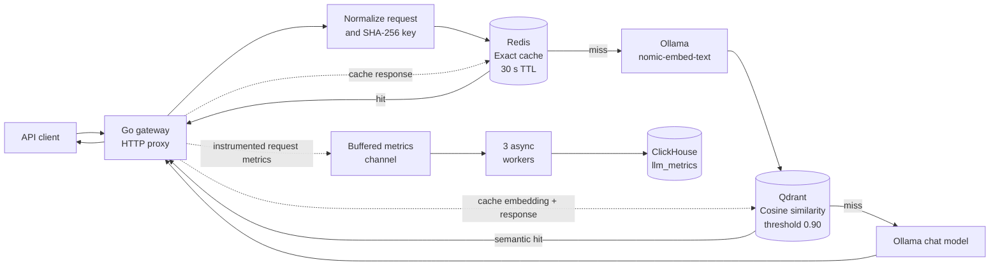
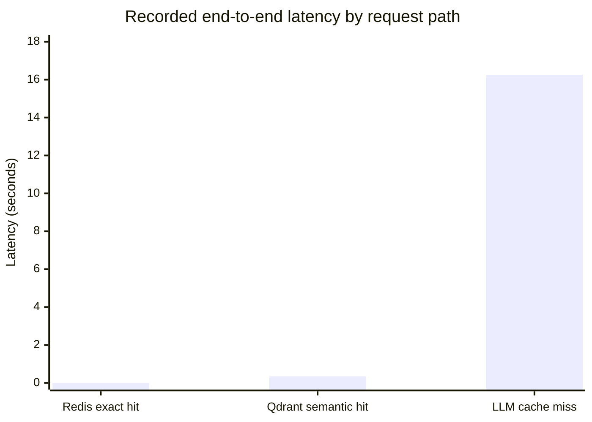

# LLM Gateway

[](https://go.dev/)
[](./LICENSE)

An OpenAI-style chat-completions gateway written in Go. It places a two-tier
cache in front of Ollama inference, supports both regular and server-sent-event
responses, and sends request telemetry to ClickHouse through an asynchronous
worker pool.

The project demonstrates API proxying, exact and semantic cache strategies,
vector search, streaming HTTP, and asynchronous telemetry in one service.

## At a glance

| Capability | Implementation |
| --- | --- |
| API | `POST /v1/chat/completions`; JSON and streaming responses |
| Exact-response cache | Redis lookup using a SHA-256 key derived from model, temperature, and messages |
| Semantic-response cache | Ollama `nomic-embed-text` embeddings queried against Qdrant |
| Similarity cutoff | Qdrant results below `0.90` are treated as misses |
| Cache write-through | Successful model responses are populated into both cache tiers asynchronously |
| Telemetry | Buffered Go channel and three ClickHouse writer workers; currently emitted for cache hits and streaming inference misses |
| Lifecycle | Signal-aware HTTP server shutdown |

## System architecture



### Request lifecycle

1. The gateway reads the chat request and builds a deterministic cache prompt
   from its model, temperature, and messages.
2. It hashes that prompt with SHA-256 and checks Redis first.
3. On a Redis miss, it asks Ollama for a prompt embedding and searches Qdrant.
   A result is reused only when its cosine similarity meets the configured
   `0.90` threshold.
4. If both cache tiers miss, the request is forwarded to `OLLAMA_URL`, the
   configured Ollama chat-completions URL. The upstream response is returned
   to the client, and the assistant response is added to both cache tiers
   asynchronously.
5. Metrics for cache hits and streaming inference misses are published to a
   buffered channel for asynchronous insertion into ClickHouse. Non-streaming
   inference misses are not currently instrumented.

Exact Redis hits avoid embedding generation. Semantic lookups still require an
Ollama embedding request before Qdrant can search, so they trade some latency
for reuse across differently worded prompts.

## Recorded latency measurements

The following end-to-end HTTP timings were recorded with `curl` for this
project:

| Request path | Samples | Average | Median | Minimum | Maximum |
| --- | ---: | ---: | ---: | ---: | ---: |
| Redis exact hit | 30 | **~7.9 ms** | ~7.0 ms | 5.741 ms | 27.687 ms |
| Qdrant semantic hit | 27 | **~349 ms** | ~349 ms | 291.819 ms | 434.043 ms |
| Cache miss → Ollama inference | 29 | **~16.25 s** | ~16.17 s | 10.283 s | 21.987 s |



These figures are observations from one environment, not service-level
guarantees. They include the applicable gateway, cache, and local model
operations; they are not isolated Redis or Qdrant microbenchmarks. Three
requests in the Qdrant run missed the semantic cache and were excluded from
the 27-hit result. The repository does not currently include an automated
benchmark harness, so reproduce comparisons under the same hardware, model,
service configuration, and warm-up conditions before using them as a
performance claim. Based on these recorded averages, Redis hits were about
2,060x lower latency than cache misses, and semantic hits about 46.6x lower;
these are ratios between the observed paths, not controlled guarantees.

## Technology

| Area | Technologies |
| --- | --- |
| Language and HTTP | Go, standard-library `net/http` |
| LLM inference and embeddings | Ollama; `nomic-embed-text`; model selected in the request (the examples use `llama3.2`) |
| Exact cache | Redis, SHA-256 cache keys |
| Semantic cache | Qdrant, dense vectors, cosine similarity |
| Analytics | ClickHouse |
| Local service orchestration | Docker Compose |

## Repository layout

```text
.
├── cmd/gateway/       # Application startup and dependency wiring
└── pkg/
    ├── cache/         # Prompt keys, Redis, embeddings, Qdrant, two-tier flow
    ├── clickhouse/    # ClickHouse client, metric insertion, worker pool
    ├── proxy/         # Chat-completions HTTP and streaming handlers
    ├── router/        # Provider configuration
    ├── telemetry/     # Metric events and buffered channel
    └── types/         # Chat request and response structures
```

## Run locally

### Requirements

- Go **1.26.6** (the version declared in `go.mod`)
- Ollama, with a chat model and the embedding model available
- Redis reachable at `localhost:6379`
- Qdrant reachable over gRPC at `localhost:6334`
- A ClickHouse endpoint reachable with TLS and the credentials described below

Pull the models used in the examples and semantic cache:

```sh
ollama pull llama3.2
ollama pull nomic-embed-text
```

### Docker setup for dependencies

Install Docker with the Compose plugin, then start the repository's
containerized Redis and Qdrant dependencies from the repository root:

```sh
docker compose up -d qdrant redis
docker compose ps
```

Compose exposes Qdrant gRPC on `localhost:6334` and Redis on
`localhost:6379`. ClickHouse is not included; configure the gateway to use your
cloud ClickHouse endpoint as described below. The gateway and Ollama are also
not included in Compose: run Ollama on the host, pull the models above, and
start the gateway with Go as described below. Compose persists Qdrant data in
`qdrant_data` and Redis data in the `redis-data` volume.


Stop the containers while retaining their data with:

```sh
docker compose down
```

### Configure

Create a `.env` file in the repository root. `CLICKHOUSE_*` values for your
cloud ClickHouse endpoint are required at startup; the gateway connects over
HTTP with TLS. Keep real credentials out of source control.

```dotenv
LLM_PROVIDER=ollama
OLLAMA_URL=http://localhost:11434/v1/chat/completions

CLICKHOUSE_HOST=<your-clickhouse-host>
CLICKHOUSE_PORT=8443
CLICKHOUSE_USER=<your-clickhouse-user>
CLICKHOUSE_PASSWORD=<your-clickhouse-password>
CLICKHOUSE_DATABASE=default
```

The current cache and service addresses are wired to local defaults in the
application: Redis at `localhost:6379`, Qdrant at `localhost:6334`, and Ollama
embeddings at `http://localhost:11434`.

### Install and start

```sh
go mod download
go run ./cmd/gateway
```

The gateway listens on `http://localhost:8080`. Its ClickHouse metrics insert
targets `default.llm_metrics`; make sure that table exists in the selected
database before sending requests.

## API example

The public route follows the OpenAI chat-completions request/response shape.
For example:

```sh
curl -X POST http://localhost:8080/v1/chat/completions \
  -H "Content-Type: application/json" \
  -d '{
    "model": "llama3.2",
    "messages": [
      {
        "role": "user",
        "content": "Explain a binary search tree in two sentences."
      }
    ]
  }'
```

Set `"stream": true` in the request body to receive server-sent events. The
request's `model` field is passed to Ollama.

## Verification

The tests cover deterministic cache-prompt/key generation, metrics-channel
buffer behavior, and Redis/Qdrant cache paths. Several cache tests require
running Redis, Qdrant, and Ollama services.

Run the service-independent tests with:

```sh
go test ./pkg/telemetry ./pkg/cache -run 'TestMetricsChannel|TestBuildCachePromptDeterministic'
```

Run the full test suite when the required backing services are available:

```sh
go test ./...
```

## Current scope and limitations

- The executable's cache-miss path currently forwards requests to the
  configured Ollama chat-completions URL. Although the router package defines
  OpenAI provider settings, OpenAI forwarding and API-key authentication are
  not wired into the request handler yet.
- Redis, Qdrant, and Ollama cache endpoints are currently local defaults rather
  than environment-configurable settings.
- The project does not currently implement gateway authentication or
  rate-limiting. Deploy it only behind controls appropriate to its environment.
- The latency numbers above are recorded measurements, not automated CI
  benchmarks or production SLOs.
